# Unitree G1 Mid360 建图

## 1. 项目介绍

本文以仓库当前代码为准，带用户完整走通一遍：

1. 查询 G1 运动状态；
2. 切换机器人状态；
3. 让机器人低速移动并安全停止；
4. 启动 Mid360 + FAST-LIO 建图；
5. 保存 PCD 点云地图。

运动控制具有真实物理风险。首次运行前请完成以下检查：

- 机器人四周留出足够空间，移除可能绊倒机器人的物体；
- 确认急停、遥控器和人工保护人员可用；
- 第一次只使用很小的速度，例如 `0.05`；
- 机器人站立和运动时不要触碰腿部、关节和传感器支架；
- 任何测试结束前都发送零速度，并按需要切回坐下或阻尼状态；
- 不要在机器人悬空、腿部被支撑或人员靠近关节时测试 `zero_torque`。

<div style="page-break-after: always;"></div>

## 2. 环境准备与编译

新建一个终端并进入工作区并编译：

```bash
cd /workspace
```

```bash
colcon build
```

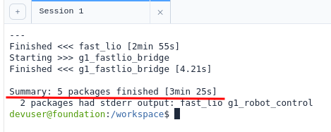

编译成功后检查 ROS2 包是否可见：

```bash
source install/setup.bash
```

```bash
ros2 pkg list | grep -E 'g1_robot_control|g1_fastlio_bridge|fast_lio'
```

检查 G1 的控制和传感器话题

```bash
ros2 topic list | grep -E 'api/sport|utlidar'
```

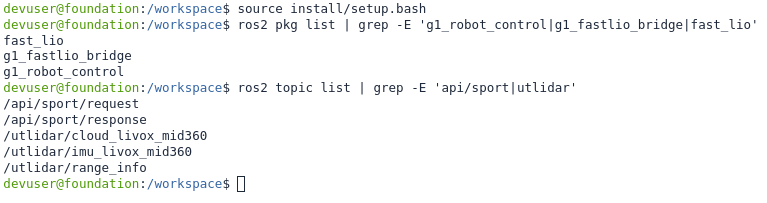

控制节点使用以下 Unitree API 话题：

| 方向 | 话题 | 用途 |
| --- | --- | --- |
| 发布 | `/api/sport/request` | 向 G1 发送运动请求 |
| 订阅 | `/api/sport/response` | 接收运动 API 应答 |

G1 Mid360 建图默认使用：

| 方向 | 话题 | 消息类型 |
| --- | --- | --- |
| 输入 | `/utlidar/cloud_livox_mid360` | `sensor_msgs/msg/PointCloud2` |
| 输入 | `/utlidar/imu_livox_mid360` | `sensor_msgs/msg/Imu` |

可以进一步查看话题类型和频率：

```bash
ros2 topic type /utlidar/cloud_livox_mid360
ros2 topic hz /utlidar/cloud_livox_mid360
ros2 topic hz /utlidar/imu_livox_mid360
```

<div style="page-break-after: always;"></div>

## 3. 状态查询与切换

查询当前 FSM ID：

```bash
ros2 run g1_robot_control g1_loco_client_example --get_fsm_id
```
常用映射：

| 命令或状态 | FSM ID | 解释 |
| --- | --- | --- |
| `zero_torque` | 0 | 零力矩模式；开机起点，不能直接行走 |
| `damp` | 1 | 阻尼模式；常用于停止、保护或切换前确认安全 |
| `squat` | 2 | 蹲姿相关状态；项目源码中封装为 `Squat()` |
| `sit` | 3 | 落座模式 |
| `stand_up` | 4 | 站起/锁定站立相关状态 |
| `set_fsm_id=706` | 706 | 用于蹲起和站蹲过渡；
| `set_fsm_id=801` | 801 | 用于从锁定站立进入走跑控制；进入后才演示速度控制 |

`g1_loco_client_example` 调用 API 后最多等待 5 秒。常见错误包括：

- `LocoState not available`：当前状态不允许该 API，或运动服务还没有准备好；
- `Invalid fsm id`：发送了固件不接受的状态 ID；
- `Invalid task id`：发送了不接受的动作任务 ID；
- `UT_ROBOT_TASK_TIMEOUT`：5 秒内没有收到匹配的响应。

控制 API 依赖 `/api/sport/request` 和 `/api/sport/response` 的请求应答链路。如果偶发出现超时返回，以get_fsm_id和机器人实际状态为准。API 请求通过 identity ID 关联响应，所以网络、DDS 或 Unitree 服务异常时，首先检查上述两个话题。

开机后，在开始运动或建图前，建议按下面顺序操作：

```bash
# 1. 查询
ros2 run g1_robot_control g1_loco_client_example --get_fsm_id

# 2. 切换到阻尼状态
ros2 run g1_robot_control g1_loco_client_example --set_fsm_id=1

# 3. 如果开机初始状态为蹲姿，使用一下命令切换到走跑状态
ros2 run g1_robot_control g1_loco_client_example --set_fsm_id=706

# 4. 确认状态
ros2 run g1_robot_control g1_loco_client_example --get_fsm_id
```

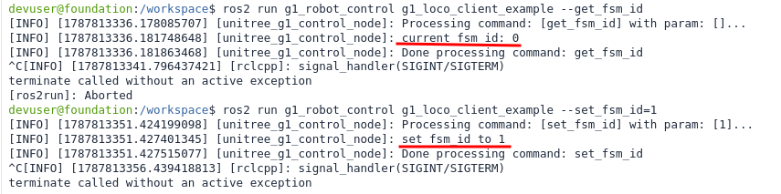

<div style="page-break-after: always;"></div>

## 4. 机器人移动

本项目提供两种移动方式：

1. `g1_loco_client_example --set_velocity=...`：发送一次、带持续时间的速度命令；
2. `g1_cmd_vel_bridge`：订阅 ROS 2 `/cmd_vel`，把速度命令转换为 Unitree API 请求。

### 4.1 一次性速度命令

参数顺序为：

```text
vx vy omega [duration]
```

例如低速向前移动 2 秒：

```bash
ros2 run g1_robot_control g1_loco_client_example \
  --set_velocity="0.3 0.0 0.0 2.0"
```

向左/右平移或原地旋转时分别调整 `vy` 和 `omega`：

```bash
# 低速横移，持续 2 秒
ros2 run g1_robot_control g1_loco_client_example \
  --set_velocity="0.0 0.3 0.0 2.0"

# 低速旋转，持续 2 秒
ros2 run g1_robot_control g1_loco_client_example \
  --set_velocity="0.0 0.0 0.5 2.0"
```

### 4.2 使用 `/cmd_vel` 桥接节点

启动桥接节点：

```bash
ros2 run g1_robot_control g1_cmd_vel_bridge
```

新建终端并以 10 Hz 发布速度，使用ctrl+c关闭pub终端，会自动发送零速度：：

```bash
ros2 topic pub --rate 10 /cmd_vel geometry_msgs/msg/Twist \
'{linear: {x: 0.5, y: 0.0, z: 0.0}, angular: {x: 0.0, y: 0.0, z: 0.0}}'
```

（也可以在第三个终端执行：ros2 run g1_robot_control g1_loco_client_example --stop_move）

停止原桥接节点，新开“G1 遥操”界面，可通过启动参数切换网页摇杆映射：

```bash
ros2 run g1_robot_control g1_cmd_vel_bridge --ros-args \
  -p web_joystick:=true
```

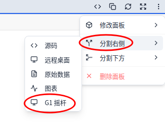

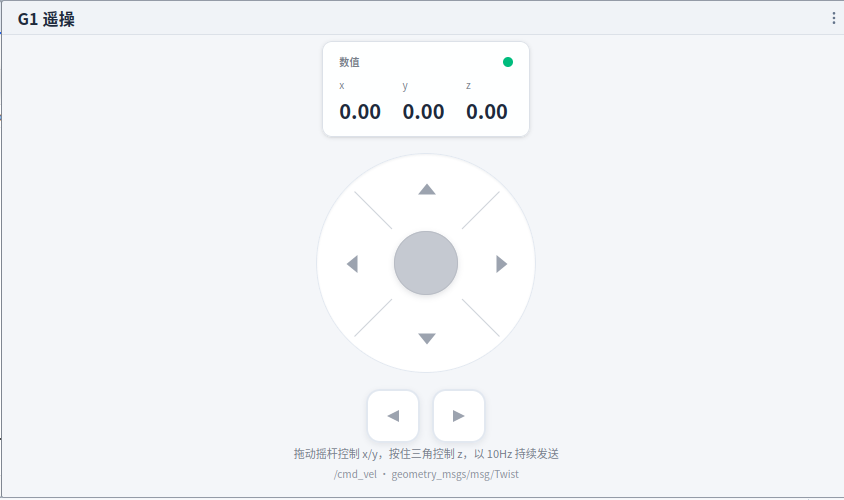

成功连接后，即可通过遥杆实时控制机器人。（体验后及时停止进程，确保安全）

<div style="page-break-after: always;"></div>

## 5. 启动 G1 Mid360 + FAST-LIO 建图

FAST-LIO 初始化阶段尽量保持机器人静止数秒，避免刚启动时立即大幅度移动。确认点云和 IMU 都在发布后，再启动建图：

```bash
ros2 topic hz /utlidar/cloud_livox_mid360
```

```bash
ros2 topic hz /utlidar/imu_livox_mid360
```

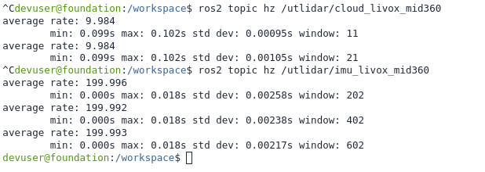

打开“远程桌面”界面，再执行以下命令：

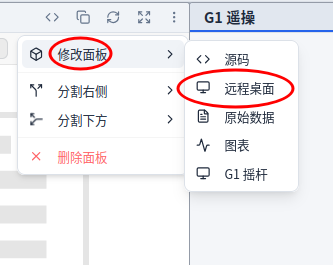

```bash
source install/setup.bash
```

```bash
ros2 launch g1_fastlio_bridge g1_fastlio_mapping.launch.py
```

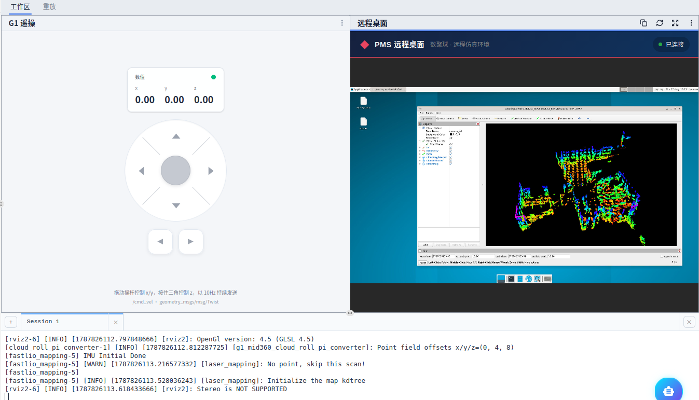

这个 launch 会同时启动：

1. `cloud_roll_pi_converter`：把倒装 Mid360 点云绕 x 轴旋转 180 度；
2. `imu_si_converter`：补充 IMU frame，并将加速度从 g 转为 `m/s^2`，同时绕 x 轴旋转 180 度；
3. 两个静态 TF 发布器；
4. `fastlio_mapping`；
5. RViz（当 `rviz:=true`）。

默认输出地图文件为：

```text
src/map/g1_fastlio.pcd
```

RViz 中重点观察：

- 点云是否稳定，不应呈现明显翻转或周期性跳动；
- 轨迹是否随机器人移动连续变化；
- 点云是否逐渐形成墙面、桌面等结构；
- `camera_init`、`body`、`base_link` 和 `livox_frame` 的 TF 是否连通。

<div style="page-break-after: always;"></div>

### 6. 建图时移动

新建终端，启动 `/cmd_vel` 桥接节点：

```bash
ros2 run g1_robot_control g1_cmd_vel_bridge --ros-args \
  -p web_joystick:=true
```

然后通过摇杆以低速、连续、小范围路线移动。

建图路线建议包含：

- 起始位置附近的一小段直线；
- 缓慢转弯；
- 能看到墙、桌腿、柱子等几何结构的区域；
- 回到起点附近，用于观察闭环前后的漂移。

本项目的 FAST-LIO 负责实时里程计和增量点云地图，不包含完整的闭环检测和全局图优化。长距离行走后出现一定累计漂移是预期现象。

结束移动时，先在发布终端按 `Ctrl-C` 停止持续速度，再显式发送停止命令：

<div style="page-break-after: always;"></div>

## 7. 保存 PCD 地图

G1 专用配置 `src/g1_fastlio_bridge/config/g1_mid360_fastlio.yaml` 中与保存相关的参数为：

```yaml
map_file_path: "src/map/g1_fastlio.pcd"

publish:
  map_en: true

pcd_save:
  pcd_save_en: true
  interval: -1
```

这里有一个重要的实现细节：`/map_save` 保存的是 `pcl_wait_pub`，而 `pcl_wait_pub` 只有在 `publish.map_en=true` 时才会通过定时器累积。因此要成功保存完整地图，必须保持 `map_en: true`，并且让 FAST-LIO 已经处理过一定数量的点云。

在建图终端保持 FAST-LIO 运行，在新终端执行：

```bash
ros2 service call /map_save std_srvs/srv/Trigger "{}"
```

成功时应看到类似结果：

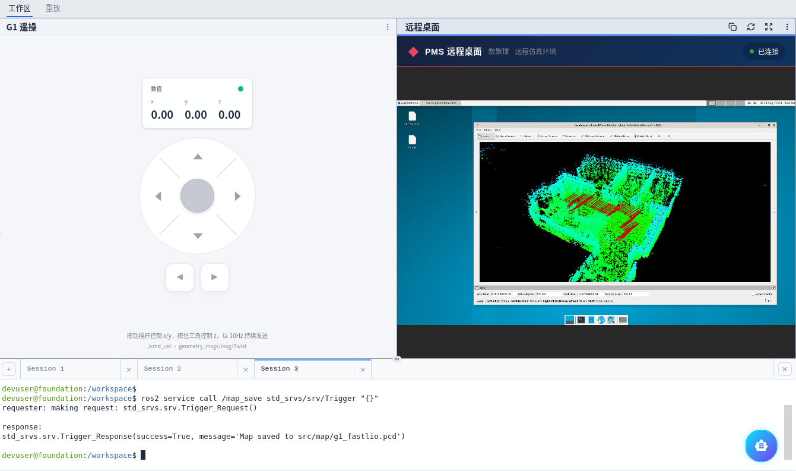

```text
success: true
message: Map saved to src/map/g1_fastlio.pcd
```

保存地图后，关闭所有终端进程，检查文件：

```bash
ls -lh src/map/g1_fastlio.pcd
```

用 PCL 查看器检查点云：

```bash
pcl_viewer src/map/g1_fastlio.pcd
```

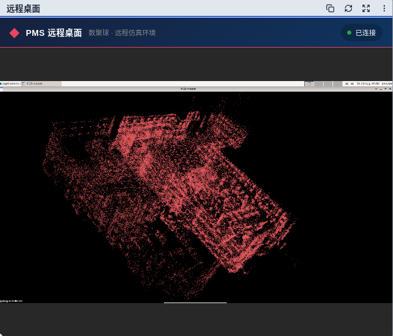

注意把地图文件保存到本地，后续导航时需要。

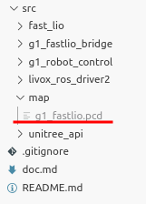

<div style="page-break-after: always;"></div>

## 8. 代码结构与工作原理

### 8.1 G1 Loco API 请求链

核心文件：

- [`loco_client_example.cpp`](src/g1_robot_control/src/loco_client_example.cpp)
- [`g1_loco_client.hpp`](src/g1_robot_control/include/g1/g1_loco_client.hpp)
- [`base_client.hpp`](src/g1_robot_control/include/common/base_client.hpp)

命令行程序启动一个 ROS 2 节点，解析形如 `--get_fsm_id`、`--set_fsm_id=4` 的参数。随后调用 `LocoClient`：

```text
命令行参数
    ↓
LocoClient
    ↓
unitree_api/msg/Request
    ↓  /api/sport/request
G1 运动服务
    ↓  /api/sport/response
unitree_api/msg/Response
    ↓
打印结果
```

每个 Loco API 都有一个 API ID。例如：

- `7001`：查询 FSM ID；
- `7002`：查询 FSM mode；
- `7101`：设置 FSM ID；
- `7105`：设置速度；
- `7107`：设置速度模式。

请求参数使用 JSON 字符串，例如速度请求的逻辑结构是：

```json
{
  "velocity": [0.05, 0.0, 0.0],
  "duration": 1.0
}
```

`BaseClient::Call` 会生成 request identity ID，发布请求，然后只接受 identity ID 相同的响应，最多等待 5 秒。这种匹配方式避免把其他请求的响应误当成当前结果。

需要注意：示例程序的多个参数会先放入 `std::map`，处理顺序是按参数名排序，而不是按命令行书写顺序。因此一次不要依赖多个动作参数的先后关系；状态切换和运动建议分成多个命令执行，并在每一步确认结果。

### 8.2 `/cmd_vel` 桥接器

核心文件：

- [`cmd_vel_bridge.cpp`](src/g1_robot_control/src/cmd_vel_bridge.cpp)

桥接器的处理过程是：

1. ROS 2 订阅 `geometry_msgs/msg/Twist`；
2. 将 x/y/z 输入限制到 `[-1, 1]`；
3. 对 x/y 应用死区；
4. 根据 `web_joystick` 决定是否交换 x/y 平移输入，乘以速度上限，并按当前实现反转横移和 yaw 符号；
5. 保存最新命令和时间戳；
6. 工作线程将其编码成 API ID `7105` 的 Unitree 请求；
7. 超过 watchdog 时间没有新命令时，发布零速度。

这里使用互斥锁、条件变量和单独工作线程，是为了让 ROS 订阅回调只负责接收最新命令，而请求发送和超时检查由控制线程完成。命令带 `0.25` 秒持续时间，外部以 10 Hz 发布时，新的请求会不断覆盖旧请求。

### 8.3 G1 Mid360 传感器预处理

核心文件：

- [`cloud_roll_pi_converter.py`](src/g1_fastlio_bridge/g1_fastlio_bridge/cloud_roll_pi_converter.py)
- [`imu_si_converter.py`](src/g1_fastlio_bridge/g1_fastlio_bridge/imu_si_converter.py)
- [`g1_fastlio_preprocess.launch.py`](src/g1_fastlio_bridge/launch/g1_fastlio_preprocess.launch.py)

G1 上的 Mid360 物理安装方向是倒置的。预处理节点对点云和 IMU 都执行绕 x 轴旋转 180 度：

```text
R_x(pi):
[x']   [1  0  0] [x]
[y'] = [0 -1  0] [y]
[z']   [0  0 -1] [z]
```

点云转换器直接遍历 `PointCloud2` 的二进制数据，按字段 offset 找到 `y` 和 `z`，写回 `-y`、`-z`，不改变点云字段布局。

IMU 转换器除了同样的姿态变换，还会：

- 当原消息没有 frame 时设置 `frame_id=body`；
- 默认将线加速度乘以 `9.80665`，把 g 转成 `m/s^2`；
- 对角速度的 y/z 分量执行相同的 180 度滚转变换。

如果实际驱动已经发布 SI 单位，应将 `accel_scale` 调为 `1.0`，否则会重复乘以重力加速度。

### 8.4 FAST-LIO

核心文件：

- [`laserMapping.cpp`](src/fast_lio/src/laserMapping.cpp)
- [`IMU_Processing.hpp`](src/fast_lio/src/IMU_Processing.hpp)
- [`ikd_Tree.cpp`](src/fast_lio/include/ikd-Tree/ikd_Tree.cpp)
- [`use-ikfom.hpp`](src/fast_lio/include/use-ikfom.hpp)

FAST-LIO 的主要数据流：

```text
LiDAR 点云 + 点时间
          +
         IMU
          ↓
按时间同步和 IMU 前向传播
          ↓
点云运动去畸变
          ↓
与 ikd-Tree 地图近邻匹配
          ↓
迭代误差状态 EKF 更新
          ↓
位姿、里程计、路径和增量地图
```

其中：

- IMU 用于在点云帧之间进行姿态、速度和位置预测；
- 点时间用于补偿一帧扫描期间机器人运动造成的点云畸变；
- ikd-Tree 支持增量插入、删除和近邻搜索，避免每帧重建静态 KD-Tree；
- 迭代误差状态 EKF 将点到局部平面/结构的残差作为观测，优化机器人状态；
- `extrinsic_T` 和 `extrinsic_R` 描述 LiDAR 在 IMU body frame 中的外参。

本项目配置中 `extrinsic_est_en: false`，表示使用给定外参，不在线估计。只有在重新标定并确认坐标系后，才应修改外参。

### 8.5 PCD 保存

`laserMapping.cpp` 中 `publish_map()` 将当前帧变换到 `camera_init` 世界坐标系，并累积到 `pcl_wait_pub`。`/map_save` 服务回调再调用 PCL 的二进制写入接口，把累计点云写入 `map_file_path`。

因此：

- `/Laser_map` 是实时发布的累计地图话题；
- `map_save` 是手动触发的快照；
- PCD 保存会消耗内存和磁盘空间；
- 保存之前应先停止移动或至少保持机器人稳定。

<div style="page-break-after: always;"></div>

## 9. 常见问题

### 找不到 `g1_robot_control` 或 `fast_lio`

重新构建并 source：

```bash
cd <ws>
colcon build 
source install/setup.bash
```

### `cmd_vel` 发布了但机器人不动

按顺序检查：

1. 机器人是否已经进入走跑模式；
2. `g1_cmd_vel_bridge` 是否仍在运行；
3. `/cmd_vel` 的消息类型是否正确；
4. 发布频率是否持续，是否超过 watchdog；
5. `linear.x` 是否在 `[-1, 1]`；
6. 是否被遥控器、急停或其他控制节点接管。

### FAST-LIO 点云翻转、发散或没有里程计

检查：

- 点云和 IMU 话题名称是否与配置一致；
- 点云是否包含 `time` 字段；
- `timestamp_unit` 是否正确；
- IMU 是否已经是 `m/s^2`，避免重复缩放；
- `rotate_roll_pi` 是否被重复应用；
- TF 是否存在且方向正确；
- LiDAR/IMU 时间戳是否同步；
- `extrinsic_T` 是否与当前安装方式匹配。

### `/map_save` 返回空地图

检查 `publish.map_en` 和 `pcd_save.pcd_save_en`，并确认已经启动了使用 G1 配置的 launch。还要确认 `/Laser_map` 已经有消息，不能在 FAST-LIO 尚未处理第一帧数据时立刻保存。

### 建图地图有漂移

当前 FAST-LIO 配置提供实时 LiDAR-IMU 里程计和增量地图，但不包含完整闭环优化。改善方式包括：

- 缓慢移动并增加环境几何约束；
- 确认 IMU 和 LiDAR 时间同步；
- 重新标定外参；
- 减少机器人震动；
- 在上层增加回环检测和全局优化模块。
