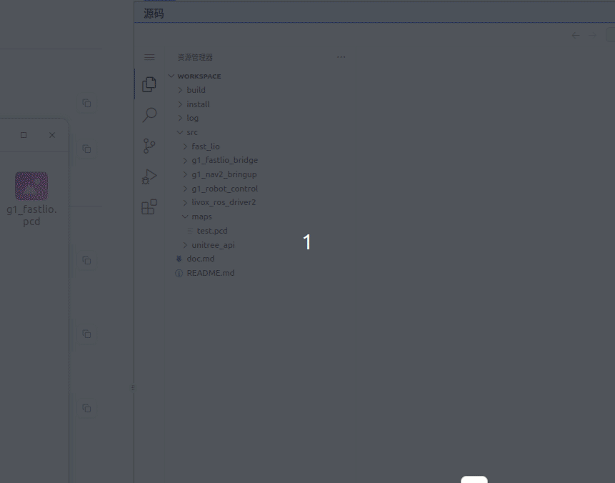
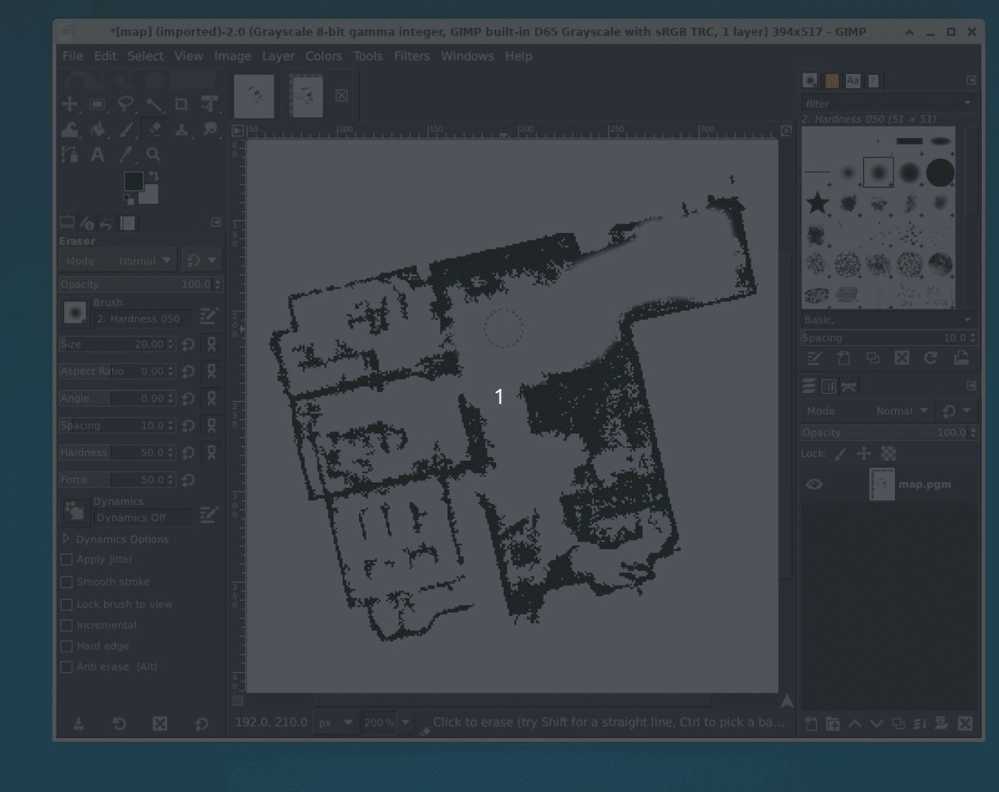
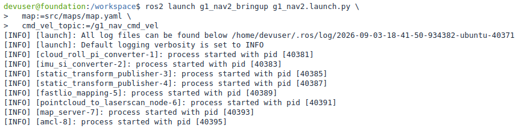
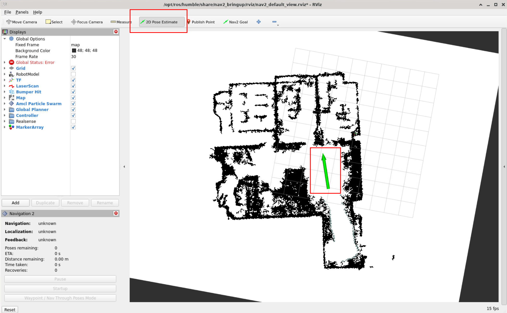
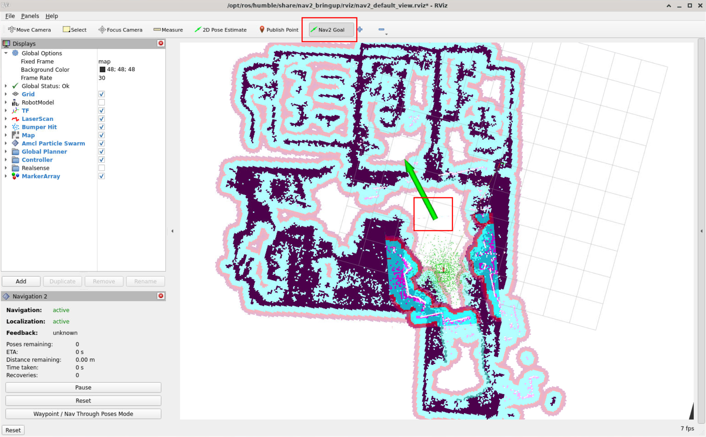

# Unitree G1 Nav2 导航

## 1. 项目介绍

本文以仓库当前代码为准，带用户完成一次 G1 + Livox Mid360 + FAST-LIO + Nav2 导航任务。

真实机器人会执行运动命令。首次运行前必须确认：

- 机器人周围有足够的空旷区域，旋转自定位时不会碰撞；
- 急停、遥控器和人工保护人员可用；
- 机器人已经站立，并处于可以接收速度命令的走跑控制状态；
- 雷达和 IMU 正常发布，且时间戳持续更新；
- 不要同时启动多个 Nav2、FAST-LIO 或速度桥接节点；
- 任何测试结束前都执行停止命令，并按需要切回阻尼状态。

本工作区中的导航速度与摇杆速度相互隔离：

```text
Nav2 controller
    -> /cmd_vel_nav
    -> velocity_smoother
    -> /g1_nav_cmd_vel
    -> g1_cmd_vel_bridge
    -> /api/sport/request
```

网页摇杆原本发布的 `/cmd_vel` 不在这条链路中，因此不会直接打断导航。

<div style="page-break-after: always;"></div>

## 2. 环境准备与编译

新建一个终端并进入工作区并编译：

```bash
cd /workspace
```

```bash
colcon build
```


<div style="page-break-after: always;"></div>

## 3. 准备地图

### 3.1 地图转换

将3D雷达建图完成后的 `g1_fastlio.pcd` 文件放入便携工作区的 `maps` 目录下：

```text
/workspace/src/maps/g1_fastlio.pcd
```



当前导航采用的是二维 Nav2 配置：`map_server` 读取 `map.yaml`，其中的`map.pgm` 被作为 `nav_msgs/msg/OccupancyGrid` 发布；全局 costmap 的`static_layer` 再读取这个二维占用栅格，`NavFn` 根据栅格中的占用单元和可通行单元规划路径，DWB 根据局部 costmap 生成速度。PCD 只是稀疏的三维点集合，不能直接作为当前 `map_server` 或 `static_layer` 的输入。

因此需要将三维点云按导航高度切片并投影成二维占用栅格，同时生成 `map.yaml` 中的分辨率和原点信息。当前系统仍然需要在线
`/scan` 更新 local/global costmap，用于检测建图后出现的临时障碍物；PGM/YAML只提供静态全局地图。

进入便携工作区并加载环境：

```bash
source install/setup.bash
```

执行下面的命令生成 PGM 和 YAML 文件：

```bash
ros2 run fast_lio pcd_to_nav2_map \
  src/maps/g1_fastlio.pcd \
  src/maps \
  0.05 \
  -1.20 \
  0.30 \
  6
```


确认 YAML 的 `image` 文件确实存在：

```bash
test -f src/maps/map.yaml && test -f src/maps/map.pgm && echo "map files OK"
```


该命令的参数顺序为：

```text
INPUT.pcd OUTPUT_DIR resolution z_min z_max min_component_cells
```

各参数含义和当前取值原因如下：

| 参数 | 当前值 | 含义和取值原因 |
| --- | --- | --- |
| `resolution` | `0.05` | 二维栅格分辨率，单位为米/像素，即一个像素代表 `5 cm x 5 cm`。该值与当前 Nav2 地图和 costmap 的 `0.05 m` 分辨率一致，在地图细节和计算量之间取平衡。值越小地图越精细，但文件、内存和计算量都会增大。 |
| `z_min` | `-1.20` | 保留点的最低 z 值，单位为米。当前 PCD 建图坐标中 z=0 是雷达高度（宇树g1标准高度为1.32m，雷达位于头部下方中心区），因此保留雷达坐标系下低于雷达 `1.20 m` 的点，用于保留地面附近及腿部、低矮障碍物的回波。 |
| `z_max` | `0.30` | 保留点的最高 z 值，单位为米。只保留雷达上方 `0.30 m` 以内的点，减少高处结构、天花板等不适合二维导航的点。与 `z_min` 一起形成 `[-1.20, 0.30] m` 的二维建图切片。 |
| `min_component_cells` | `6` | 最小连通区域的像素数。8 邻域连通区域小于 6 个栅格的点会被删除，用于去除孤立噪声和点云配准产生的小碎片；保留较大的墙、桌腿等连续障碍物。值太大可能删除细小但真实的障碍物，值太小则噪声会更多。 |

转换器的处理过程是：先删除 z 范围外和无效点，再将保留点投影到二维栅格，然后删除小连通区域。没有点的位置初始化为可通行区域，保留的障碍点写入占用栅格，最后生成 PGM 图像和 Nav2 使用的 YAML 元数据。该过程不是实时定位，也不会替代导航时的在线 `/scan` 避障。

理论上可以使用支持点云、体素地图或三维碰撞检测的其他规划器直接处理 PCD，但那需要更换当前的地图、costmap 和规划器链路，不属于本项目现有的二维 Nav2导航流程。

### 3.1 地图完善与修复

如果转换后的地图仍然存在一些问题，可以使用gimp工具改善。

打开远程桌面并执行下面的命令：


```bash
gimp src/maps/map.pgm
```

使用拖动工具调整位置，放大工具放大地图：


使用橡皮擦工具擦除地图中的噪声：


然后导出修复后的地图文件：



最后关闭gimp工具，在‘远程桌面’查看修改后地图：

```bash
display src/maps/map.pgm
```


<div style="page-break-after: always;"></div>

## 4. 启动前检查机器人接口

机器人端或已有驱动必须提供以下接口：

| 方向 | 话题 | 类型 | 用途 |
| --- | --- | --- | --- |
| 输入 | `/utlidar/cloud_livox_mid360` | `sensor_msgs/msg/PointCloud2` | Mid360 点云 |
| 输入 | `/utlidar/imu_livox_mid360` | `sensor_msgs/msg/Imu` | Mid360 IMU |
| 双向 | `/api/sport/request` | Unitree API 消息 | 运动请求 |
| 双向 | `/api/sport/response` | Unitree API 消息 | 运动响应 |

检查雷达和 IMU：

```bash
ros2 topic list -t | grep -E 'livox|imu|api/sport'
ros2 topic type /utlidar/cloud_livox_mid360
ros2 topic type /utlidar/imu_livox_mid360
ros2 topic hz /utlidar/cloud_livox_mid360
ros2 topic hz /utlidar/imu_livox_mid360
```


确认运动状态：

```bash
ros2 run g1_robot_control g1_loco_client_example --get_fsm_id
```

根据实际机器人状态切换到项目使用的走跑控制状态。`801` 是本项目导航速度桥使用的走跑控制状态；蹲姿开机状态可直接通过`1` 和 `706` 切换到走跑模式，具体以真机固件允许的状态转换为准：


```bash
# 查询
ros2 run g1_robot_control g1_loco_client_example --get_fsm_id

# 如果当前处于蹲姿，执行；已经允许走跑时可跳过
ros2 run g1_robot_control g1_loco_client_example --set_fsm_id=706

# 进入导航使用的走跑控制状态
ros2 run g1_robot_control g1_loco_client_example --set_fsm_id=801

# 再次确认，应为 801 的可行走状态
ros2 run g1_robot_control g1_loco_client_example --get_fsm_id
```

<div style="page-break-after: always;"></div>

## 5. 启动导航系统

确认地图路径后，在终端 1 执行：

```bash
source install/setup.bash
```

```bash
ros2 launch g1_nav2_bringup g1_nav2.launch.py \
  map:=src/maps/map.yaml \
  cmd_vel_topic:=/g1_nav_cmd_vel
```

该启动文件会启动：

1. G1 Mid360 点云和 IMU 预处理；
2. FAST-LIO 局部里程计；
3. `pointcloud_to_laserscan`，将点云切片转换为 `/scan`；
4. Nav2 的 map server、AMCL、planner、DWB controller、costmap 和行为节点；
5. G1 导航速度桥接节点；
6. 自动全局定位节点（默认关闭，只有显式启用时才启动）。

默认局部控制器是 Nav2 内置 DWB：

- 全局规划器：`NavFn`；
- 局部规划器：`dwb_core::DWBLocalPlanner`；
- 最大前进速度：`0.60 m/s`；
- 最大自转速度：`0.80 rad/s`；
- DWB、velocity smoother、行为节点和 G1 速度桥均使用上述上限；
- 导航不使用横向速度；
- 到点位置误差：`0.40 m`；
- 到点角度误差：`0.45 rad`。



在手动定位前，如果日志出现以下错误信息，属于正常情况：
[planner_server-12] [INFO] [1788432188.708915670] [global_costmap.global_costmap]: Timed out waiting for transform from base_link to map to become available, tf error: Invalid frame ID "map" passed to canTransform argument target_frame - frame does not exist

<div style="page-break-after: always;"></div>

## 6. 打开 RViz 并发送目标

新建终端并执行：

```bash
source install/setup.bash
```

```bash
ros2 launch g1_nav2_bringup g1_nav2_rviz.launch.py
```

在RViz 地图中点击 `2D Pose Estimate` 设置机器人当前位置和朝向：



等 AMCL 粒子云稳定后，点击 `Nav2 Goal` 设置目标：



设置目标点后，机器人就会自动开始导航。

<div style="page-break-after: always;"></div>

## 7. 常见问题

### 7.1 `Invalid frame ID "map"` 或地图没有显示

检查地图参数和生命周期：

```bash
ros2 param get /map_server yaml_filename
ros2 lifecycle get /map_server
```

如果是 `unconfigured` 或 `inactive`，检查 `map:=` 是否指向存在的 YAML，且
YAML 中的 `image` 路径正确。退出所有旧的 Nav2 进程后重新启动，避免多个同名
节点造成参数查询混乱。

### 7.2 RViz 显示地图但机器人没有位姿

依次检查：

```bash
ros2 topic hz /utlidar/cloud_livox_mid360
ros2 topic hz /utlidar/imu_livox_mid360
ros2 topic hz /Odometry
ros2 topic echo --once /scan
ros2 run tf2_ros tf2_echo camera_init base_link
```

没有 `/scan` 通常是点云类型、点云输入话题或高度切片不匹配；没有
`camera_init -> base_link` 通常是 FAST-LIO 未启动、IMU/点云没有数据或 TF 时间戳
异常。

### 7.3 RViz 报消息时间戳早于 TF 缓存

这通常表示传感器时间戳和 TF 时间基准不一致，或 FAST-LIO 刚启动时缓存尚未
建立。先保持机器人静止数秒再观察；如果持续出现，检查 `/utlidar/cloud_livox_mid360`、
`/utlidar/imu_livox_mid360` 和 `/Odometry` 的时间戳是否连续，确保所有节点使用相同的
`use_sim_time` 设置。

### 7.4 DWB 报 `Failed to make progress`

先确认机器人实际处于走跑状态，再检查 `/g1_nav_cmd_vel` 是否有非零输出：

```bash
ros2 topic echo /g1_nav_cmd_vel
```

当前 G1 低于约 `0.30 m/s` 的非零线速度可能无法起步，低于约 `0.30 rad/s`
的非零角速度可能无法自转。导航桥接已按该执行特性设置最小速度；如果机器人
仍不动，检查 FSM、API 响应和急停状态。

### 7.5 紧急停止

立即关闭发送导航目标的终端或取消目标，并执行：

```bash
ros2 run g1_robot_control g1_loco_client_example --stop_move
```

必要时使用遥控器或急停装置。导航进程退出前也会由速度桥接 watchdog 发送停止
命令，但不能替代人工急停。
